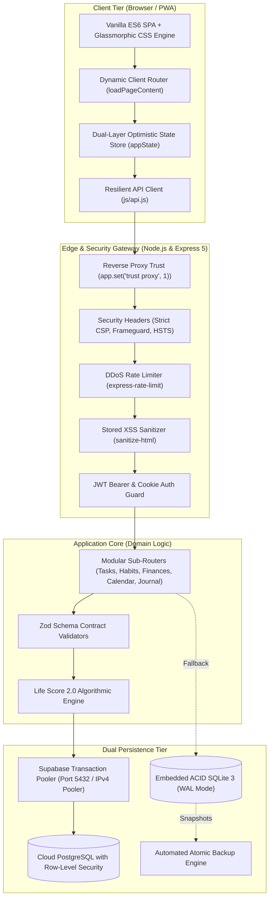

<div align="center">

```text
  ██╗     ██╗███████╗███████╗     ██████╗ ███████╗
  ██║     ██║██╔════╝██╔════╝    ██╔═══██╗██╔════╝
  ██║     ██║█████╗  █████╗      ██║   ██║███████╗
  ██║     ██║██╔══╝  ██╔══╝      ██║   ██║╚════██║
  ███████╗██║██║     ███████╗    ╚██████╔╝███████║
  ╚══════╝╚═╝╚═╝     ╚══════╝     ╚═════╝ ╚══════╝
```

### ⚡ THE HIGH-PERFORMANCE PERSONAL COMMAND CENTER & LIFE ANALYTICS ENGINE

*A production-grade, privacy-first personal productivity operating system. Engineered with embedded ACID SQLite (WAL mode), dual Supabase cloud sync, mathematical Life Score analytics, interactive time-blocking, and a sleek dark glassmorphic UI.*

<br/>

[](https://os-yat2.onrender.com)
[](https://nodejs.org/)
[](https://sqlite.org/)
[](#-security-hardening)
[](https://www.docker.com/)
[](LICENSE)

<br/>

<p align="center">
  <a href="#-core-pillars"><b>Core Pillars</b></a> •
  <a href="#-system-architecture"><b>Architecture</b></a> •
  <a href="#-life-score-mathematical-engine"><b>Life Score Engine</b></a> •
  <a href="#-repository-structure"><b>Repo Anatomy</b></a> •
  <a href="#-keyboard-shortcuts"><b>Shortcuts</b></a> •
  <a href="#-quick-start"><b>Quick Start</b></a> •
  <a href="#-api-reference"><b>API Reference</b></a> •
  <a href="#-cloud-deployment"><b>Deployment</b></a>
</p>

---

</div>

<br/>

## 🌟 Why Life OS?

Most productivity setups scatter your focus across five disjointed subscriptions—one for habit tracking, another for tasks, a third for finance, a calendar app, and an encrypted note-taking app.

**Life OS consolidates everything into a single, cohesive, self-hosted command center:**

- 🔒 **100% Privacy & Sovereign Data:** Zero third-party telemetry, advertisements, or hidden analytics. All data belongs exclusively to you.
- ⚡ **Dual Persistence Engine:** Powered by SQLite with Write-Ahead Logging (`WAL`) locally, with automatic high-availability synchronization to Cloud PostgreSQL (Supabase Connection Pooler).
- 🛡️ **Zero-Trust Multi-Tenancy:** Hardened tenant isolation via strict `WHERE user_id = ?` parameter binding, bcrypt credential hashing, and signed JWT session management.
- 📈 **Life Score 2.0 Engine:** Algorithmic scoring across five core lifestyle dimensions, giving you mathematical clarity on your daily momentum.
- 📱 **Sleek Glassmorphic Design:** Tailored high-contrast dark aesthetic with fluid mobile drawer navigation, haptic micro-animations, and instant load speeds.

---

## 💎 Core Pillars

<table width="100%">
  <tr>
    <td width="50%" valign="top">
      <h3>🎯 1. Habit Mastery & Streaks</h3>
      <ul>
        <li><b>Visual Consistency Matrix:</b> Daily check-in grid with dynamic streak counting</li>
        <li><b>Day-Part Grouping:</b> Organize routines into <i>Morning</i>, <i>Afternoon</i>, and <i>Evening</i></li>
        <li><b>Zero-Latency Optimistic UI:</b> Instant client toggle with background sync</li>
        <li><b>Momentum Anchors:</b> Custom reminder cues and motivational triggers</li>
      </ul>
    </td>
    <td width="50%" valign="top">
      <h3>⚡ 2. Focus Tasks & Priorities</h3>
      <ul>
        <li><b>4-Tier Priority Engine:</b> <code>Urgent</code>, <code>High</code>, <code>Medium</code>, and <code>Low</code></li>
        <li><b>Contextual Categorization:</b> Work, Personal, Fitness, Study, and Projects</li>
        <li><b>Real-Time Completion Ratios:</b> Instant velocity calculations per period</li>
        <li><b>Quick Capture:</b> Rapid modal creation with keyboard shortcut <kbd>T</kbd></li>
      </ul>
    </td>
  </tr>
  <tr>
    <td width="50%" valign="top">
      <h3>💰 3. Dual-Entry Indian Finance Tracker</h3>
      <ul>
        <li><b>Rupee-Standard Cashflow:</b> Clean integer currency formatting (₹)</li>
        <li><b>Income vs. Expense Balance:</b> Real-time monthly surplus and deficit</li>
        <li><b>Savings Rate Curve:</b> Algorithmic financial health scoring</li>
        <li><b>Continuous Press-and-Hold:</b> Mobile-friendly 1-unit quantity steppers</li>
      </ul>
    </td>
    <td width="50%" valign="top">
      <h3>📅 4. Interactive 24h Time Blocking</h3>
      <ul>
        <li><b>Visual Schedule Grid:</b> 24-hour visual block allocation</li>
        <li><b>Intelligent Recurrence:</b> Daily, Weekdays, or Custom repeating blocks</li>
        <li><b>Live Day Progress:</b> Dynamic completion bar and active block indicators</li>
        <li><b>Touch Optimized:</b> Generous thumb targets for mobile screens</li>
      </ul>
    </td>
  </tr>
  <tr>
    <td width="50%" valign="top">
      <h3>📖 5. Deep Reflection Journal</h3>
      <ul>
        <li><b>6 Reflection Categories:</b> Deep Work, Breakthrough, Gratitude, Idea...</li>
        <li><b>Focus Writer Window:</b> Distraction-free full-screen writing mode</li>
        <li><b>Search & History:</b> Sub-millisecond client-side note indexing</li>
        <li><b>Stored XSS Protected:</b> Strict sanitization filters before persistence</li>
      </ul>
    </td>
    <td width="50%" valign="top">
      <h3>🌟 6. Star Chart & Analytics</h3>
      <ul>
        <li><b>Radar Balance Chart:</b> Holistic multi-dimensional lifestyle equilibrium</li>
        <li><b>Periodic Segmented Filters:</b> Seamless toggle between <code>Week</code>, <code>Month</code>, and <code>Overall</code></li>
        <li><b>Prime Growth Identification:</b> Highlights lowest scoring pillar automatically</li>
        <li><b>Historical Snapshots:</b> Track lifestyle momentum trajectory over months</li>
      </ul>
    </td>
  </tr>
</table>

---

## 🏛️ System Architecture



---

## 📐 Life Score Mathematical Engine

The **Life Score** computes a mathematically sound momentum score from **0% to 100%**, balancing 5 core lifestyle pillars with strict boundary conditions:

$$\mathbf{\text{Life Score}} = \sum_{i=1}^{5} w_i \cdot S_i \in [0, 100]\%$$

$$\mathbf{\text{Life Score}} = 0.25 \, S_{\text{habits}} + 0.25 \, S_{\text{tasks}} + 0.20 \, S_{\text{finances}} + 0.15 \, S_{\text{goals}} + 0.15 \, S_{\text{schedule}}$$

```text
 0% ─────────────────────────── 50% ────────────────────────── 100%
 [ 🧱 Baseline Horizon ]   [ ⚡ High Achiever ]   [ 👑 Mythic Immortal ]
```

| Dimension | Weight | Mathematical Model | Description |
| :--- | :---: | :--- | :--- |
| **Habits & Routine** | **25%** | $0.80 \times \text{Rate} + 0.20 \times \min(100, \text{Bonus})$ | Daily check-in adherence + capped streak multiplier |
| **Task Execution** | **25%** | $\frac{\text{Completed Eligible Tasks}}{\text{Total Eligible Tasks}} \times 25$ | Task completion velocity weighted by priority tier |
| **Financial Health** | **20%** | Savings Rate Curve ($\ge 50\% \to 100\%$, $\ge 20\% \to 85\%$) | Surplus ratio of monthly Income over Expenses |
| **Strategic Goals** | **15%** | $\frac{1}{N} \sum_{k=1}^{N} \text{Milestone}_k \times 15$ | Average milestone progress across active OKRs |
| **Time & Schedule** | **15%** | $\frac{\text{Completed Blocks}}{\text{Total Scheduled Blocks}} \times 15$ | Realized calendar adherence across 24h day |

### 🏆 Mastery Tiers & Progression

- 👑 **Mythic Immortal** (90% – 100%) — Flawless consistency across all 5 life pillars
- 💎 **Grandmaster** (80% – 89%) — Exceptional discipline and high execution velocity
- ⚡ **Master** (70% – 79%) — Stable, harmonious daily lifestyle equilibrium
- 🌟 **High Achiever** (55% – 69%) — Solid upward momentum with minor growth areas
- 🌱 **Rising Horizon** (0% – 54%) — Foundational building phase; room for rapid growth

---

## 📂 Repository Structure

The codebase is cleanly organized following modern production standards:

```text
LIFE-OS/
├── 📁 assets/                     # Application visual assets & PWA graphics
│   └── 📁 icons/                  # High-res PWA icons, apple touch icons & vectors
├── 📁 data/                       # Embedded SQLite ACID database & schema backups
├── 📁 js/                         # Modular client-side controllers (API, UI, State)
├── 📁 pages/                      # SPA sub-views (habits, tasks, calendar, finances...)
├── 📁 scripts/                    # Database maintenance & automated backup scripts
├── 📁 src/                        # Hardened backend architecture (Express 5 REST API)
│   ├── 📁 config/                 # Environment validation & runtime configuration
│   ├── 📁 db/                     # Dual Supabase PostgreSQL + SQLite repository
│   ├── 📁 middleware/             # Helmet security, rate limiting, sanitization & auth
│   └── 📁 routes/                 # Partitioned multi-tenant RESTful route handlers
├── 📁 tests/                      # Automated unit, regression & security test suites
├── 📄 .dockerignore               # Container build exclusions
├── 📄 .env.example                # Environment configuration template
├── 📄 .gitignore                  # Git tracking rules
├── 📄 CONTRIBUTING.md             # Contribution guidelines & development setup
├── 📄 docker-compose.yml          # Production multi-container orchestration
├── 📄 Dockerfile                  # Multi-stage production container build
├── 📄 favicon.svg                 # Scalable minimalist atom brand favicon
├── 📄 index.html                  # Single-Page Application (SPA) shell
├── 📄 LICENSE                     # MIT Open Source License
├── 📄 manifest.json               # Progressive Web App (PWA) manifest
├── 📄 package.json                # Project dependencies, scripts & metadata
├── 📄 README.md                   # Visual project documentation
├── 📄 script.js                   # Reactive client-side application engine
├── 📄 SECURITY.md                 # Security & responsible disclosure policy
├── 📄 server.cjs                  # Production Express.js HTTP application server
└── 📄 style.css                   # Unified dark glassmorphic design system
```

---

## ⌨️ Power-User Keyboard Shortcuts

Navigate and capture thoughts at the speed of thought without touching your mouse:

| Keybinding | Action | Scope |
| :---: | :--- | :--- |
| <kbd>A</kbd> | Open **Achievements & Mastery Tiers** modal | Global |
| <kbd>C</kbd> | Navigate to **Interactive Calendar** | Global |
| <kbd>T</kbd> | Open **Focus Tasks & Priorities** | Global |
| <kbd>Esc</kbd> | Immediately close any open modal or popover | Global |
| <kbd>?</kbd> | Display **Keyboard Shortcuts Cheatsheet** | Global |
| <kbd>Ctrl</kbd> + <kbd>K</kbd> / <kbd>⌘</kbd> + <kbd>K</kbd> | Open Quick Search & Command Palette | Global |
| <kbd>G</kbd> then <kbd>H</kbd> | Go to **Home Dashboard** | Chords |
| <kbd>G</kbd> then <kbd>F</kbd> | Go to **Finances** | Chords |
| <kbd>G</kbd> then <kbd>J</kbd> | Go to **Journal** | Chords |
| <kbd>G</kbd> then <kbd>S</kbd> | Go to **Settings** | Chords |

---

## 🚀 Quick Start

### Prerequisites
- **Node.js** v20.0.0+ LTS recommended
- **npm** v9.0.0+

### 1. Clone & Install
```bash
# Clone repository
git clone https://github.com/farzzz-ux/LIFE-OS.git
cd LIFE-OS

# Install dependencies
npm install
```

### 2. Configure Environment
```bash
# Create local environment configuration
cp .env.example .env
```

Edit your `.env` configuration:
```env
PORT=3000
NODE_ENV=development
JWT_SECRET=your-secure-random-jwt-secret-key-32-chars-min
DB_PATH=./data/lifeos.db

# Optional: Cloud PostgreSQL persistence (Supabase)
# DATABASE_URL=postgresql://postgres:[PASSWORD]@[HOST]:5432/postgres
```

### 3. Launch Server
```bash
# Launch development server
npm run dev

# Or launch production server
npm start
```

Visit **[http://localhost:3000](http://localhost:3000)** in your browser!

---

## 🐳 Containerized Deployment (Docker)

Deploy anywhere in seconds with Docker Compose:

```bash
# 1. Build and run in detached mode
docker compose up -d --build

# 2. Verify container health
docker compose ps

# 3. Stream real-time logs
docker compose logs -f
```

All SQLite database records, schema updates, and backups persist safely on the host volume at `./data`.

---

## ☁️ Cloud Deployment (Render.com)

1. Fork or push this repository to your GitHub account.
2. Sign in to [Render.com](https://render.com) and click **New +** $\to$ **Web Service**.
3. Select your **`LIFE-OS`** repository.
4. Set environment settings:
   - **Runtime:** `Docker`
   - **Branch:** `main`
   - **Plan:** `Free`
5. Under **Environment Variables**, define:
   - `NODE_ENV` = `production`
   - `PORT` = `3000`
   - `JWT_SECRET` = `<your-secure-production-secret>`
   - `DATABASE_URL` = `<your-supabase-connection-pooler-url>` *(Optional)*
6. Click **Create Web Service**. Your app is live with automatic SSL! 🚀

---

## 📡 RESTful API Reference

<details>
<summary><b>🔐 Authentication Endpoints</b> (Click to expand)</summary>

| Method | Endpoint | Description | Auth Required |
| :--- | :--- | :--- | :---: |
| `POST` | `/api/auth/register` | Register new user account with hashed password | ❌ |
| `POST` | `/api/auth/login` | Authenticate user and issue signed JWT token | ❌ |
| `GET` | `/api/auth/me` | Fetch currently authenticated user session | ✅ |
| `POST` | `/api/auth/logout` | Clear authenticated session cookies | ❌ |
| `POST` | `/api/auth/reset-password` | Request password reset verification | ❌ |

</details>

<details>
<summary><b>📦 State Synchronization & Health</b> (Click to expand)</summary>

| Method | Endpoint | Description | Auth Required |
| :--- | :--- | :--- | :---: |
| `GET` | `/api/user/data` | Retrieve requesting tenant's complete state | ✅ |
| `POST` | `/api/user/data` | Perform atomic multi-pillar state synchronization | ✅ |
| `GET` | `/health` / `/api/health` | Container & service liveness health check | ❌ |

</details>

<details>
<summary><b>🛠️ Resource CRUD Endpoints</b> (Click to expand)</summary>

| Method | Endpoint | Description |
| :--- | :--- | :--- |
| `GET` / `POST` | `/api/habits` | Retrieve or create daily habits |
| `POST` | `/api/habits/:id/toggle` | Toggle habit checkmark for specific calendar date |
| `GET` / `POST` | `/api/tasks` | Retrieve or create focus priority tasks |
| `PUT` / `DELETE` | `/api/tasks/:id` | Update or remove existing task |
| `GET` / `POST` | `/api/finances` | Log income or expense transaction in rupees |
| `GET` / `POST` | `/api/schedule` | Retrieve or block daily calendar schedule slots |
| `GET` / `POST` | `/api/journal` | Retrieve or write structured reflection entry |
| `GET` / `POST` | `/api/goals` | Retrieve or create OKR milestone targets |
| `GET` / `POST` | `/api/scores/snapshots`| Persist or query historical Life Score snapshots |
| `GET` / `POST` | `/api/mood` | Record or query daily emotional vitality index |

</details>

---

## 🛡️ Security Hardening

- **Zero-Trust Multi-Tenancy:** Strict tenant isolation on every SQL query (`WHERE user_id = ?`).
- **Supabase Row-Level Security (RLS):** All 10 cloud tables protected with authenticated user access policies.
- **Stored XSS Sanitization:** Deep recursive sanitization via `sanitize-html` neutralizes malicious payloads.
- **HTTP Security Headers:** Protected with `helmet` Content Security Policy (CSP), clickjacking protection (`SAMEORIGIN`), and MIME-sniff prevention.
- **Brute-Force Rate Limiting:** Dynamic request throttling powered by `express-rate-limit`.
- **Bcrypt Password Encryption:** Salting and hashing with industry-standard bcrypt rounds.

---

## 🧪 Automated Testing

Life OS includes comprehensive automated test suites covering data persistence, mathematical scoring, security isolation, and UI responsiveness:

```bash
# Execute test suite
npm test
```

```text
✔ Life Score: Exact weights sum up to 100% (25/25/20/15/15)
✔ Life Score: Strict Monday-to-Sunday weekly boundaries
✔ Security Isolation: Cross-tenant data leak protection
✔ Security Sanitization: Stored XSS attacks neutralized
✔ Double-Checking Protection: Safety confirmation dialogs
✔ Phone Viewport & Touch Optimization Verification
```

---

## 📄 License

This project is licensed under the **[MIT License](LICENSE)**.

<br/>

<div align="center">
  <sub>Engineered with precision for human potential by <a href="https://github.com/farzzz-ux"><b>farzzz-ux</b></a>. Star ⭐ the repository if you love it!</sub>
</div>
