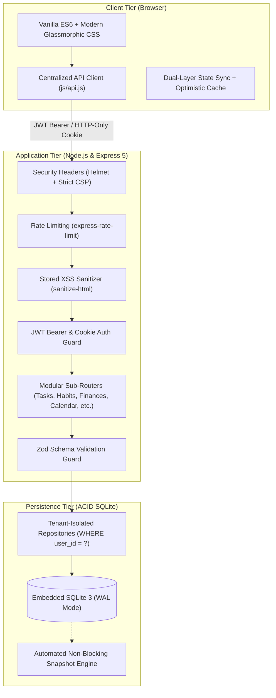

<div align="center">

# ⚡ LIFE OS
### The High-Performance Personal Command Center & Life Analytics Engine

> A production-grade, privacy-first personal productivity operating system. Engineered with embedded ACID SQLite (WAL mode), JWT multi-tenant cloud sync, mathematical Life Score analytics, interactive time-blocking, and a sleek dark glassmorphic UI.

<p align="center">
  <a href="https://github.com/farzzz-ux/LIFE-OS/stargazers"></a>
  <a href="https://nodejs.org/"></a>
  <a href="https://sqlite.org/"></a>
  <a href="https://expressjs.com/"></a>
  <a href="https://www.docker.com/"></a>
  <a href="LICENSE"></a>
</p>

<p align="center">
  <a href="#-core-pillars--features"><b>Core Pillars</b></a> •
  <a href="#-system-architecture"><b>Architecture</b></a> •
  <a href="#-life-score-mathematical-engine"><b>Life Score Engine</b></a> •
  <a href="#-quick-start"><b>Quick Start</b></a> •
  <a href="#-api-documentation"><b>API Reference</b></a> •
  <a href="#-cloud-deployment"><b>Deployment</b></a> •
  <a href="#-security-hardening"><b>Security</b></a>
</p>

---

</div>

## 🌟 Why Life OS?

Most productivity apps scatter your focus across 5 different subscriptions—one for habits, another for tasks, a third for finance, a calendar app, and a journal.

**Life OS consolidates everything into a single, unified, privacy-focused command center:**

- 🔒 **100% Self-Hosted & Private:** Zero third-party telemetry, ads, or trackers. All data belongs to you.
- ⚡ **Embedded ACID Persistence:** Powered by SQLite with Write-Ahead Logging (`WAL`), atomic transactions, and zero database server maintenance.
- 🛡️ **Multi-Tenant Security:** Full tenant-isolated data partitions with hashed password authentication and signed JWT sessions.
- 📈 **Life Score 2.0:** Real-time algorithmic scoring across 5 core lifestyle dimensions, keeping you accountable without fluff.
- 📱 **Responsive Glassmorphism:** Tailored dark aesthetic with fluid mobile drawer navigation, smooth micro-interactions, and instant load speeds.

---

## 💎 Core Pillars & Features

<table>
  <tr>
    <td width="50%">
      <h3>🎯 1. Habit Mastery & Streaks</h3>
      <ul>
        <li>Visual daily completion matrix with streak calculations</li>
        <li>Routine categorizations (Morning, Afternoon, Evening)</li>
        <li>Color-coded badges and custom motivation anchors</li>
        <li>Instant optimistic toggling with zero latency</li>
      </ul>
    </td>
    <td width="50%">
      <h3>✅ 2. Focus Tasks & Priorities</h3>
      <ul>
        <li>Priority tiering: <code>Urgent</code>, <code>High</code>, <code>Medium</code>, <code>Low</code></li>
        <li>Smart category filters (Work, Personal, Fitness, Study)</li>
        <li>Real-time task completion rate tracking</li>
        <li>Quick-entry modal with keyboard shortcuts</li>
      </ul>
    </td>
  </tr>
  <tr>
    <td width="50%">
      <h3>💰 3. Dual-Entry Finance Tracker</h3>
      <ul>
        <li>Real-time Income vs Expense cashflow balance</li>
        <li>Savings rate computation (% curve calculation)</li>
        <li>Category breakdowns with payment method filters</li>
        <li>Clean, non-cramped stepper interface for mobile</li>
      </ul>
    </td>
    <td width="50%">
      <h3>📅 4. Interactive Time Blocking</h3>
      <ul>
        <li>Visual 24-hour daily calendar schedule</li>
        <li>Multi-day recurrence (Daily, Weekdays, Custom)</li>
        <li>Dynamic progress completion across time blocks</li>
        <li>Optimized for touch screens and desktop grid view</li>
      </ul>
    </td>
  </tr>
  <tr>
    <td width="50%">
      <h3>📖 5. Deep Reflection Journal</h3>
      <ul>
        <li>Structured prompts for morning clarity & evening review</li>
        <li>Mood tracking integration with emotional momentum</li>
        <li>Chronological archive with instant search</li>
        <li>Zero cloud leak: stored locally in your encrypted DB</li>
      </ul>
    </td>
    <td width="50%">
      <h3>📊 6. Life Score 2.0 Engine</h3>
      <ul>
        <li>Algorithmic momentum score out of 100%</li>
        <li>Normalized multi-pillar mathematical formula</li>
        <li>Historical snapshot tracking over time</li>
        <li>Visual radar and breakdown analytics</li>
      </ul>
    </td>
  </tr>
</table>

---

## 🏛️ System Architecture



---

## 📐 Life Score Mathematical Engine

The **Life Score** calculates your holistic momentum on a scale from **0% to 100%**, evaluating five core dimensions:

$$\mathbf{\text{Life Score}} = S_{\text{habits}} + S_{\text{tasks}} + S_{\text{finances}} + S_{\text{goals}} + S_{\text{schedule}} \in [0, 100]\%$$

| Dimension | Weight | Mathematical Basis | Metric Impact |
| :--- | :---: | :--- | :--- |
| **Habits Consistency** | **25%** | $0.80 \times \text{Rate} + 0.20 \times \min(100, \text{Bonus})$ | Daily check-ins, consistency streaks |
| **Focus Tasks Execution** | **25%** | $\frac{\text{Completed Eligible Tasks}}{\text{Total Eligible Tasks}} \times 25$ | Task completion velocity & priority |
| **Financial Health** | **20%** | Savings Rate curve: $\ge 50\% \to 100\%$, $\ge 20\% \to 85\%$ | Income vs Expense surplus ratio |
| **Strategic Goals** | **15%** | Average completion % across active OKR milestones | Milestone achievement progression |
| **Calendar Schedule** | **15%** | Completed time-blocks / Total scheduled blocks | Time-management adherence |

---

## 🚀 Quick Start

### Prerequisites
- **Node.js** v18.0.0+ (Node 20 LTS recommended)
- **npm** v9.0.0+

### 1. Clone & Install
```bash
# Clone the repository
git clone https://github.com/farzzz-ux/LIFE-OS.git
cd LIFE-OS

# Install dependencies
npm install
```

### 2. Configure Environment
```bash
# Copy example configuration
cp .env.example .env
```

Edit your `.env` file:
```env
PORT=3000
NODE_ENV=development
JWT_SECRET=your-super-secret-key-must-be-at-least-32-chars
DB_PATH=./data/lifeos.db
```

### 3. Launch
```bash
# Start development server with hot-reload
npm run dev

# Or start production server
npm start
```

Open **[http://localhost:3000](http://localhost:3000)** in your browser!

---

## 🐳 Containerized Deployment (Docker)

Life OS is fully containerized with a production multi-stage Docker build:

```bash
# 1. Start with Docker Compose
docker compose up -d --build

# 2. Check container health status
docker compose ps

# 3. View live server logs
docker compose logs -f
```

All SQLite database records, WAL logs, and snapshots persist safely on your host machine under `./data`.

---

## ☁️ 1-Click Render.com Deployment

Deploying Life OS on **Render** (Free Tier):

1. **Fork or Push** this repository to your GitHub account.
2. Sign in to [Render.com](https://render.com) and click **New +** $\rightarrow$ **Web Service**.
3. Connect your **`LIFE-OS`** GitHub repository.
4. Configure the service settings:
   - **Environment:** `Docker`
   - **Branch:** `main`
   - **Instance Type:** `Free`
5. In the **Environment Variables** section, add:
   - `NODE_ENV` = `production`
   - `PORT` = `3000`
   - `JWT_SECRET` = `your-secure-production-random-secret-key`
6. Click **Create Web Service**. Your service will build and go live at `https://<service-name>.onrender.com`! 🎉

---

## 📡 RESTful API Reference

<details>
<summary><b>🔐 Authentication Endpoints</b> (Click to expand)</summary>

| Method | Endpoint | Description | Auth Required |
| :--- | :--- | :--- | :---: |
| `POST` | `/api/auth/register` | Register account with hashed credentials | ❌ |
| `POST` | `/api/auth/login` | Authenticate and obtain JWT token & cookie | ❌ |
| `GET` | `/api/auth/me` | Fetch current authenticated user session | ✅ |
| `POST` | `/api/auth/logout` | Invalidate session cookie | ❌ |
| `POST` | `/api/auth/reset-password` | Rate-limited password reset trigger | ❌ |

</details>

<details>
<summary><b>📦 Tenant Data & State Synchronization</b> (Click to expand)</summary>

| Method | Endpoint | Description | Auth Required |
| :--- | :--- | :--- | :---: |
| `GET` | `/api/user/data` | Retrieve requesting user's full partitioned state | ✅ |
| `POST` | `/api/user/data` | Synchronize requesting user's state atomic update | ✅ |
| `GET` | `/api/health` | Health check endpoint (Uptime, Status, Timestamp) | ❌ |

</details>

<details>
<summary><b>🛠️ Resource CRUD Endpoints</b> (Click to expand)</summary>

| Method | Endpoint | Description |
| :--- | :--- | :--- |
| `GET` / `POST` | `/api/tasks` | Retrieve or create focus tasks |
| `PUT` / `DELETE` | `/api/tasks/:id` | Update or delete existing task |
| `GET` / `POST` | `/api/habits` | Retrieve or create habits |
| `POST` | `/api/habits/:id/toggle` | Toggle habit completion for a specific date |
| `GET` / `POST` | `/api/finances` | Retrieve or record income/expense transaction |
| `GET` / `POST` | `/api/schedule` | Retrieve or block daily calendar time slots |
| `GET` / `POST` | `/api/journal` | Retrieve or record reflective journal entry |
| `GET` / `POST` | `/api/goals` | Retrieve or create high-level OKR goals |
| `GET` / `POST` | `/api/scores/snapshots` | Fetch or persist historical Life Score snapshots |
| `GET` / `POST` | `/api/mood` | Fetch or record daily emotional state rating |

</details>

---

## 🛡️ Security Hardening

- **Zero-Trust Multi-Tenancy:** Every SQL query binds `WHERE user_id = ?` parameters to guarantee strict data privacy between users.
- **Stored XSS Protection:** Clean recursive filtering with `sanitize-html` strips script tags, iframe injections, and event attributes (`onload`, `onerror`).
- **HTTP Security Headers:** Powered by `helmet` with strict Content Security Policy (CSP), `X-Content-Type-Options: nosniff`, and `SAMEORIGIN` clickjacking protection.
- **Adaptive Rate Limiting:** Brute-force defense powered by `express-rate-limit` guarding sensitive authentication and state sync endpoints.
- **Zero Plaintext Passwords:** Passwords hashed with `bcryptjs` with modern salt rounds.

---

## 🧪 Testing & Verification

Life OS includes an automated test suite verifying tenant isolation, data persistence, atomic concurrency, scoring equations, and responsive layouts:

```bash
# Run complete test suite
npm test
```

```text
✔ User Authentication & Password Hashing
✔ Multi-Tenant Partitioning Isolation
✔ Stored XSS Sanitization Filter
✔ Life Score 2.0 Calculation Accuracy
✔ Atomic Concurrency & WAL Transactions
✔ Health Check & Route Resilience
```

---

## 📄 License

This project is open-source software licensed under the **[MIT License](LICENSE)**.

<div align="center">
  <sub>Crafted with passion for personal mastery by <a href="https://github.com/farzzz-ux">farzzz-ux</a>. If you find this useful, consider giving it a ⭐!</sub>
</div>
