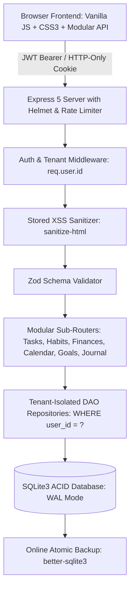

# 🌌 Life OS — Full-Stack Personal Command Center & Analytics Engine

> A production-ready, security-hardened, multi-user productivity operating system with ACID-compliant SQLite embedded database persistence (WAL mode), JWT cloud sync, tenant-isolated data partitions, mathematically weighted Life Score analytics, optimistic UI updates, interactive time-blocking, habit streaks, dual-entry finance tracking, and reflective journaling.

[](https://nodejs.org/)
[](https://sqlite.org/)
[](https://opensource.org/licenses/MIT)
[](http://localhost:3000/api/health)
[](#-security-architecture)

---

## 📑 Table of Contents
1. [Architecture Overview](#-architecture-overview)
2. [Multi-User Tenant Isolation & Schema](#-multi-user-tenant-isolation--schema)
3. [Security Architecture & Hardening](#-security-architecture--hardening)
4. [Life Score Mathematical Engine](#-life-score-mathematical-engine)
5. [RESTful API Reference](#-restful-api-reference)
6. [Prerequisites & Installation](#-prerequisites--installation)
7. [Environment Variables (`.env.example`)](#-environment-variables)
8. [Database Migration](#-database-migration)
9. [Automated Backups & Retention](#-automated-backups--retention)
10. [Docker & Containerized Deployment](#-docker--containerized-deployment)
11. [Verification & Automated Test Suite](#-verification--automated-test-suite)

---

## 🏛 Architecture Overview



- **Backend:** Modular Node.js / Express framework (`server.cjs`, `src/routes/*`, `src/middleware/*`) with centralized error formatting and standardized responses `{ success, message, error_code }`.
- **Database Layer:** ACID-compliant SQLite via `better-sqlite3` with Write-Ahead Logging (`WAL`), foreign key enforcement (`PRAGMA foreign_keys = ON;`), and composite primary keys `(user_id, id)`.
- **Security:** Helmet HTTP headers (CSP, HSTS, SAMEORIGIN frame protection), CORS headers, rate limiting (`express-rate-limit`) on sensitive auth & API routes, and deep XSS sanitization (`sanitize-html`).
- **Frontend Architecture:** Vanilla ES6 modules, optimistic UI mutations with rollback snapshots, centralized API client (`js/api.js`), and toast notifications for network status and token lifecycle (`js/ui.js`).

---

## 🔒 Multi-User Tenant Isolation & Schema

Every database table strictly incorporates a foreign key referencing `users(id)` and a composite primary key `(user_id, id)` with dedicated B-Tree indexes:

```sql
-- 1. Users
CREATE TABLE users (
  id TEXT PRIMARY KEY,
  email TEXT UNIQUE NOT NULL,
  name TEXT NOT NULL,
  password_hash TEXT NOT NULL,
  created_at TEXT NOT NULL
);

-- 2. Habits (Tenant Isolated)
CREATE TABLE habits (
  id TEXT NOT NULL,
  user_id TEXT NOT NULL REFERENCES users(id) ON DELETE CASCADE,
  name TEXT NOT NULL,
  category TEXT DEFAULT 'Health',
  routine TEXT DEFAULT 'Morning',
  motivation TEXT DEFAULT '',
  color TEXT DEFAULT 'emerald',
  completed_dates TEXT DEFAULT '[]',
  created_at TEXT NOT NULL,
  updated_at TEXT,
  PRIMARY KEY (user_id, id)
);

-- 3. Tasks (Tenant Isolated)
CREATE TABLE tasks (
  id TEXT NOT NULL,
  user_id TEXT NOT NULL REFERENCES users(id) ON DELETE CASCADE,
  title TEXT NOT NULL,
  priority TEXT DEFAULT 'medium',
  category TEXT DEFAULT 'Work',
  due_date TEXT DEFAULT 'Today',
  completed INTEGER DEFAULT 0,
  completed_at TEXT,
  created_at TEXT NOT NULL,
  PRIMARY KEY (user_id, id)
);

-- 4. Calendar Events (Tenant Isolated)
CREATE TABLE calendar_events (
  id TEXT NOT NULL,
  user_id TEXT NOT NULL REFERENCES users(id) ON DELETE CASCADE,
  title TEXT NOT NULL,
  date TEXT NOT NULL,
  hour REAL DEFAULT 9,
  start_hour REAL DEFAULT 9,
  duration REAL DEFAULT 1,
  duration_hours REAL DEFAULT 1,
  category TEXT DEFAULT 'Work',
  recurrence TEXT DEFAULT 'once',
  repeat_days TEXT DEFAULT '[]',
  completed INTEGER DEFAULT 0,
  completed_dates TEXT DEFAULT '[]',
  created_at TEXT NOT NULL,
  updated_at TEXT,
  PRIMARY KEY (user_id, id)
);

-- 5. Financial Records (Tenant Isolated)
CREATE TABLE financial_records (
  id TEXT NOT NULL,
  user_id TEXT NOT NULL REFERENCES users(id) ON DELETE CASCADE,
  description TEXT NOT NULL,
  amount REAL NOT NULL,
  type TEXT NOT NULL,
  category TEXT DEFAULT 'General',
  payment_method TEXT DEFAULT 'UPI',
  date TEXT NOT NULL,
  created_at TEXT NOT NULL,
  PRIMARY KEY (user_id, id)
);

-- 6. Journal Entries (Tenant Isolated)
CREATE TABLE journal_entries (
  id TEXT NOT NULL,
  user_id TEXT NOT NULL REFERENCES users(id) ON DELETE CASCADE,
  title TEXT NOT NULL,
  category TEXT DEFAULT 'Reflection',
  content TEXT DEFAULT '',
  date TEXT NOT NULL,
  created_at TEXT NOT NULL,
  PRIMARY KEY (user_id, id)
);

-- 7. Goals (Tenant Isolated)
CREATE TABLE goals (
  id TEXT NOT NULL,
  user_id TEXT NOT NULL REFERENCES users(id) ON DELETE CASCADE,
  title TEXT NOT NULL,
  category TEXT DEFAULT 'Career',
  target_date TEXT,
  progress REAL DEFAULT 0,
  status TEXT DEFAULT 'in-progress',
  metrics TEXT DEFAULT '',
  description TEXT DEFAULT '',
  milestones TEXT DEFAULT '[]',
  created_at TEXT NOT NULL,
  PRIMARY KEY (user_id, id)
);

-- 8. LifeScore Logs (Tenant Isolated)
CREATE TABLE lifescore_logs (
  id TEXT NOT NULL,
  user_id TEXT NOT NULL REFERENCES users(id) ON DELETE CASCADE,
  period_type TEXT NOT NULL,
  period_key TEXT NOT NULL,
  start_date TEXT,
  end_date TEXT,
  scores TEXT NOT NULL,
  formula_version TEXT DEFAULT '2.0-5pillar',
  is_baseline INTEGER DEFAULT 0,
  calculated_at TEXT NOT NULL,
  PRIMARY KEY (user_id, id)
);
```

Every database query in `src/db/repository.cjs` strictly validates and appends `WHERE user_id = req.user.id`. Requests without authorization resolve safely to an isolated guest tenant `default`.

---

## 🛡 Security Architecture & Hardening

1. **Environment & Secrets Failsafe:** In `NODE_ENV=production`, server startup aborts immediately if default or weak secrets are detected (`JWT_SECRET.length < 32`).
2. **Rate Limiting & DoS Mitigation:** `express-rate-limit` enforces threshold limits on `/api/auth/login`, `/api/auth/register`, and `/api/auth/reset-password` as well as a general rate ceiling across the `/api` surface.
3. **Helmet HTTP Headers:** Strict CSP, HSTS (`Strict-Transport-Security: max-age=31536000`), `X-Frame-Options: SAMEORIGIN` (clickjacking mitigation), and `X-Content-Type-Options: nosniff`.
4. **CORS & Secure Cookies:** Explicit CORS configuration with credentials and `SameSite=lax/strict` HTTP-only cookies.
5. **Stored XSS Neutralization:** Recursive sanitization using `sanitize-html` removes script injections and dangerous event handlers (`onload`, `onerror`, `javascript:`) before payload data touches the database.
6. **Strict Schema Validation:** Zod schemas validate every incoming POST and PUT payload, rejecting malformed structures with `400 Bad Request`.

---

## 🧮 Life Score Mathematical Engine

The Life Score evaluates personal momentum across 5 distinct pillars normalized to **100%**:

$$\text{Life Score} = S_{\text{habits}} + S_{\text{tasks}} + S_{\text{finances}} + S_{\text{goals}} + S_{\text{schedule}} \in [0, 100]\%$$

| Dimension | Weight | Formula & Basis |
| :--- | :---: | :--- |
| **Habits Consistency** | **25%** | $0.80 \times \text{CompletionRate} + 0.20 \times \min(100, \text{StreakBonus})$ |
| **Focus Tasks Execution** | **25%** | $\frac{\text{Completed Eligible Tasks}}{\text{Total Eligible Tasks}} \times 25$ |
| **Financial Health** | **20%** | Savings Rate curve: $\ge 50\% \to 100\%$, $\ge 20\% \to 85-100\%$, $\ge 0\% \to 60-85\%$ |
| **Strategic Goals** | **15%** | Average target progress across active OKRs |
| **Calendar Schedule** | **15%** | Ratio of scheduled time-blocks completed |

---

## 🔌 RESTful API Reference

### Authentication Endpoints
- `POST /api/auth/register` — Register a new user account with hashed password and initial partition.
- `POST /api/auth/login` — Verify credentials and return signed JWT token + HTTP-only cookie.
- `GET /api/auth/me` — Return current authenticated user profile (`requireAuth`).
- `POST /api/auth/logout` — Clear session authentication cookie.
- `POST /api/auth/reset-password` — Rate-limited password reset trigger.

### Tenant Data Endpoints
- `GET /api/user/data` — Retrieve requesting user's full partitioned state (`requireAuth`).
- `POST /api/user/data` — Synchronize requesting user's partitioned state (`requireAuth`).
- `GET /api/data` — Full state fetch (authenticated tenant or guest partition).
- `POST /api/sync` — Universal state synchronization.
- `GET /api/health` — System uptime, version, and database statistics.

### Resource CRUD Endpoints
- `GET /api/tasks`, `POST /api/tasks`, `PUT /api/tasks/:id`, `DELETE /api/tasks/:id`
- `GET /api/habits`, `POST /api/habits`, `PUT /api/habits/:id`, `POST /api/habits/:id/toggle`, `DELETE /api/habits/:id`
- `GET /api/finances`, `POST /api/finances`, `DELETE /api/finances/:id`
- `GET /api/schedule`, `POST /api/schedule`, `PUT /api/schedule/:id`, `DELETE /api/schedule/:id`
- `GET /api/journal`, `POST /api/journal`, `DELETE /api/journal/:id`
- `GET /api/goals`, `POST /api/goals`, `PUT /api/goals/:id`, `DELETE /api/goals/:id`
- `GET /api/scores/snapshots`, `POST /api/scores/snapshots`
- `GET /api/mood`, `POST /api/mood`

---

## 🚀 Prerequisites & Installation

### Prerequisites
- **Node.js:** v18.0.0 or higher (v20+ recommended)
- **npm:** v9.0.0 or higher

### Local Installation
```bash
# 1. Clone the repository
git clone https://github.com/your-org/life-os-tracker.git
cd life-os-tracker

# 2. Install dependencies
npm install

# 3. Create your environment configuration
cp .env.example .env

# 4. Migrate database from legacy db.json (if upgrading)
npm run migrate

# 5. Start development or production server
npm run dev
# or
npm start
```

Access the application in your browser at: **[http://localhost:3000](http://localhost:3000)**

---

## ⚙️ Environment Variables

Copy `.env.example` to `.env` and configure:

```dotenv
# Application Port
PORT=3000

# Environment Mode: 'development' | 'production' | 'test'
NODE_ENV=development

# JWT Secret Key (MUST be at least 32 characters in production)
JWT_SECRET=lifeos-cloud-sync-super-secure-production-jwt-token-key-2026

# Database Path
DB_PATH=./data/lifeos.db

# Backup Retention (number of snapshots to retain)
BACKUP_RETENTION_COUNT=7

# Rate Limiting (requests per 15 minutes window)
AUTH_RATE_LIMIT_MAX=100
API_RATE_LIMIT_MAX=1000
```

---

## 📦 Database Migration

If you have existing data stored in `data/db.json`, run the migration utility to import all users, habits, tasks, finances, schedule blocks, journal entries, goals, and scores into SQLite:

```bash
npm run migrate
```

The migration runs inside an ACID database transaction, ensuring zero data loss and idempotent imports.

---

## 💾 Automated Backups & Retention

Life OS includes an online SQLite snapshot tool that creates transactionally consistent backups without taking the application offline:

```bash
# Run on-demand backup
npm run backup
```

- **Output Directory:** `data/backups/lifeos_backup_<timestamp>.db`
- **Retention Policy:** Automatically keeps the most recent 7 backups (configured via `BACKUP_RETENTION_COUNT`) and purges older archives.
- **Automation:** Add `npm run backup` to a system cron job or task scheduler for daily snapshots.

---

## 🐳 Docker & Containerized Deployment

### Using Docker Compose (Recommended)

```bash
# 1. Build and start the container in detached mode
docker compose up -d --build

# 2. View container logs
docker compose logs -f

# 3. Check health status
docker compose ps
```

The `docker-compose.yml` mounts `./data:/app/data` to ensure all SQLite database files, WAL logs, and snapshots persist across container restarts.

### Standalone Docker Build

```bash
# Build the multi-stage image
docker build -t lifeos:latest .

# Run container with volume mount
docker run -d \
  --name lifeos-app \
  -p 3000:3000 \
  -v $(pwd)/data:/app/data \
  --env-file .env \
  lifeos:latest
```

---

## 🧪 Verification & Automated Test Suite

Life OS includes a comprehensive test suite testing API functionality, atomic concurrency, scoring algorithms, mobile responsiveness, theme persistence, and cross-tenant security isolation.

```bash
npm test
```

### Test Coverage Highlights:
- **Tenant Isolation:** Confirms User A cannot read, update, or delete User B's tasks, habits, finances, schedule, goals, or journal entries.
- **XSS Sanitization:** Confirms `<script>` and malicious attributes are neutralized on input.
- **Rate Limiting:** Confirms sensitive auth routes are protected against brute-force attacks.
- **Atomic Concurrency:** Confirms rapid parallel write operations maintain database consistency.
- **Scoring Engine:** Mathematical validation of all 5 Life Score pillars and boundary edge cases.

---

## 📄 License

MIT © [LifeOS Engineering](https://github.com/your-org)
